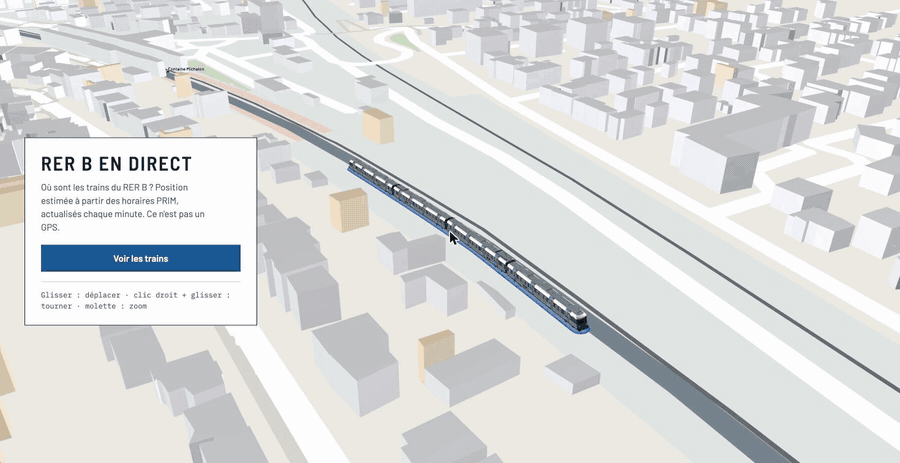

# RER B en direct

Où est le RER B que j'attends ? Une carte 3D qui place les trains de la ligne B sur leur tracé, à partir des horaires temps réel d'Île-de-France Mobilités (PRIM).

**https://rerb-live.vercel.app**



**La position est estimée, pas mesurée.** PRIM ne publie pas de GPS pour le RER B, seulement les heures de passage prévues et révisées à chaque gare. La carte interpole entre deux gares le long du tracé réel de la ligne. L'erreur dépend de la précision des heures annoncées ; un train dont la position n'est pas fiable est signalé comme tel.

## Ce que montre la carte

- les rames en 3D (modèle Z 8100) sur le tracé, avec un code couleur d'état : à quai, en route, terminé, données anciennes ou position inconnue ;
- le décor 3D de la ligne (bâtiments OpenStreetMap, hauteurs de la BD TOPO de l'IGN) ;
- la recherche d'une gare et les prochains trains qui y passent ;
- le suivi d'un train, le filtre par direction, le passage 2D / 3D, la légende et le niveau de précision.

## Comment ça marche

```
PRIM (estimated-timetable) → relevé toutes les 60 s → lissage des heures → position à l'instant t → /trains → carte (deck.gl)
```

- `rerb/` : la logique, en bibliothèque standard Python seulement (pas de dépendance à installer). `position.py` estime la position, `lissage.py` évite les sauts quand PRIM révise une heure, `gare.py` sert les prochains trains d'une gare.
- `web/` : le site statique (deck.gl 9.4.1, polices et données servies en local, aucun CDN).
- `api/` : les trois fonctions Vercel (`/trains`, `/gare`, `/sante`). Elles partagent leur état (relevé, lissage, compteurs, verrou) dans Upstash Redis, de sorte que plusieurs copies de la fonction ne font jamais plus d'un appel PRIM par minute.
- `outils/` : génération des fichiers du site (`generer_geo.py`, scripts du décor 3D) et banc de mesure de la fluidité.

Garde-fous sur le quota PRIM (1 500 requêtes par jour pour cette API) : un appel par minute au plus, aucun appel entre 01 h et 05 h (heure de Paris, pas de service), plafond de 1 300 appels par jour, blocage de 15 min après un 429 et de 6 h après un 401 ou 403, et jamais d'appel si le stockage est indisponible.

## Lancer en local

Sans clé PRIM, avec des trains inventés :

```bash
python3 rerb/serveur.py --demo
```

puis http://127.0.0.1:8765/. Avec les vraies données, copier `.env.example` en `.env`, renseigner `PRIM_API_KEY` (clé gratuite sur [prim.iledefrance-mobilites.fr](https://prim.iledefrance-mobilites.fr)), puis lancer `python3 rerb/serveur.py`.

## Tests

```bash
bash .claude/check.sh
```

Environ 700 tests, sans réseau ni clé.

## Déployer sur Vercel

1. Créer le projet à partir de ce dépôt (le dossier de sortie est `web/`, voir `vercel.json`).
2. Ajouter une base Upstash Redis depuis le Marketplace Vercel (variables `KV_REST_API_*`).
3. Définir `PRIM_API_KEY` en variable d'environnement de production (type sensible).

`vercel.json` pose les en-têtes de sécurité (CSP stricte, HSTS, `nosniff`, `no-referrer`) et les règles de cache.

## Données et licences

- **PRIM** : horaires temps réel, Licence Mobilités.
- **OpenStreetMap** : décor et fond de carte, ODbL. © les contributeurs d'OpenStreetMap.
- **BD TOPO** (IGN) : hauteurs des bâtiments, Licence Ouverte 2.0.
- **deck.gl** (MIT) et polices Barlow et IBM Plex Mono (SIL OFL 1.1) : provenance et sommes de contrôle dans `web/vendor/VERSIONS.md` et `web/fonts/VERSIONS.md`.

Aucune donnée brute d'historique n'est publiée dans ce dépôt. Les clés vont dans `.env` (ignoré par git), jamais dans le dépôt.
